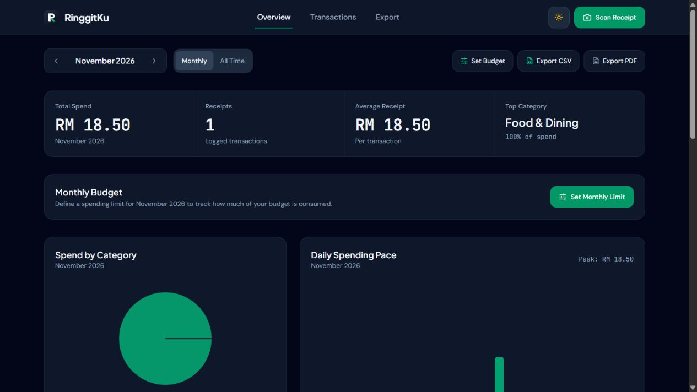
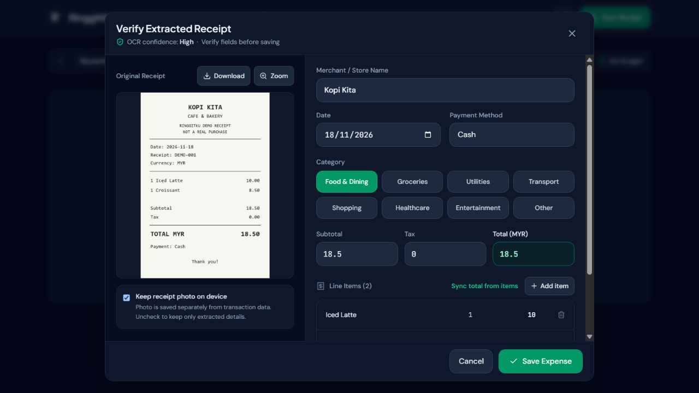

# RinggitKu

A personal expense-tracking PWA built with Google AI Studio. Photograph or upload a receipt, let Gemini extract its details, then review and save the expense.

**Status:** personal prototype. This repository contains the Google AI Studio version of RinggitKu, separate from the earlier `wilanwell/ringgitku` project.



## Why I built it

The details were already on the receipt; I was typing them out again. RinggitKu explores whether AI-assisted receipt entry can make that recurring task easier. The project also applies learning from Google AI for App Building, with a badge issued by Coursera.

## Main workflow

1. Capture a receipt with the camera, upload an image, or use a built-in sample.
2. Run image-quality checks and extract receipt details using the Gemini API.
3. Compare the original receipt with editable merchant, date, category, payment, amount and line-item fields.
4. Save the expense and inspect the monthly overview, budget indicators and spending charts.
5. Export transaction details as CSV or PDF.

The PWA supports capturing receipts offline and queues extraction until connectivity returns. **AI extraction itself requires Internet access.**



## Stack and design decisions

| Area | Implementation |
| --- | --- |
| UI | React, TypeScript, Tailwind CSS, Lucide icons |
| Build and PWA | Vite and vite-plugin-pwa |
| API server | Express with the Google Gen AI SDK |
| Receipt extraction | `gemini-3.5-flash-lite`, structured output, timeout and retry handling |
| Transaction records, budgets and offline scan queue | Browser localStorage |
| Saved receipt images | IndexedDB, stored separately from transaction records |
| Reporting | Recharts, CSV generation and jsPDF |

Receipt photos are separated from the smaller transaction records to reduce pressure on localStorage. Users can choose photo retention and see storage warnings. Review remains part of the workflow because AI extraction can need correction.

There is currently **no cloud database, cloud backup or cross-device synchronisation**. Cloud backup and sync are possible next steps, with cost and complexity still to be evaluated.

## Run locally

Use **Node.js 24 LTS** and npm. The production start command runs TypeScript directly with Node's built-in support.

```sh
npm ci
```

Copy `.env.example` to `.env`, then replace the placeholder with your own Gemini API key. Keep the key on the server and out of Git commits.

PowerShell:

```powershell
Copy-Item .env.example .env
```

macOS / Linux:

```sh
cp .env.example .env
```

Start the development server:

```sh
npm run dev
```

Open `http://localhost:3000`. Set `PORT` in the environment if that port is already used. Camera access requires localhost or an HTTPS origin.

### Build and type-check

```sh
npm run lint
npm run build
```

### Serve a production build locally

After building, set `NODE_ENV=production` and run `npm start`.

PowerShell:

```powershell
$env:NODE_ENV = 'production'
npm start
```

macOS / Linux:

```sh
NODE_ENV=production npm start
```

`npm run preview` serves only Vite's frontend preview. Use the Express server above for a complete local app with the receipt extraction endpoint.

## API usage and cost

Extraction calls the Gemini API. Free-tier availability, quotas and paid rates depend on the selected model and project configuration. API usage does not automatically mean a monetary charge. See [Google's model pricing](https://aistudio.google.com/docs/pricing#gemini-3.5-flash-lite).

Cost per successfully recorded receipt and actual time saved have **not** been measured. An evaluation should include capture, waiting, retries where applicable, review and corrections. This repository does not include an API key or assert that this particular project's API usage is free or paid.

## Current limitations

- Browser storage can fill up or be cleared/evicted. Expense records and photos are not a guaranteed backup.
- The offline scan queue also uses localStorage and can encounter capacity limits.
- CSV/PDF exports contain transaction details; they are not a complete backup-and-restore system for the whole app and its photos.
- Extraction depends on provider availability, API permissions, quotas and image quality. A successful sample scan does not establish accuracy on all receipts.
- Cloud backup, sync, accounts and server-side access controls are not implemented in this version. Add appropriate access controls and usage limits before exposing your own API-backed deployment broadly.

## Verification and provenance

See [verification notes](docs/VERIFICATION.md) for the distinction between observed live tests and repository checks.

- Source was exported from the current [Google AI Studio project](https://aistudio.google.com/apps/2c883397-2cb5-4313-89a7-52594b4955ec) on 19 November 2026. The server retains the OCR model change used in the successful demo.
- The npm packaging aligns esbuild with Vite's peer dependency and includes a lockfile for repeatable installation.
- PNG PWA icons are regenerated from the original `public/icon.svg`; the original Apple touch icon is retained.
- Screenshots use a clearly labelled synthetic receipt. Personal receipt photos, expense exports, raw recordings and credentials are excluded.
- This repository is a source-code export, not an automatic two-way GitHub sync or a new production deployment.
